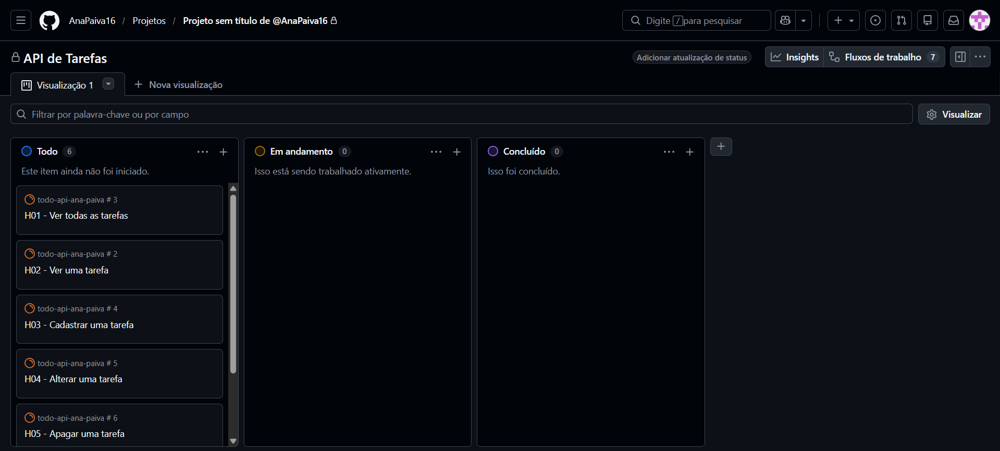

# API de Tarefas

**Aluno(a):** Ana Júlia de Lima Paiva

API de gestão de tarefas feita com Node.js, Express e MySQL, no padrão MVC.

## Como rodar

1. `npm install`
2. Copie o arquivo `.env.example` para `.env` e coloque a senha do seu MySQL.
3. No MySQL Workbench, abra e rode o arquivo `src/database/todo.sql` (raio ⚡).
4. `npm run dev` → o terminal mostra `Conectado ao MySQL!`.
5. Para conferir a API, em outro terminal: `npm run conferir`.

## Endpoints

_(Sprint 2: uma linha para cada rota da API)_

| Método | Rota | O que faz | Status de sucesso |
|---|---|---|:---:|
| GET | /tarefas | Lista todas as tarefas (com suporte a filtros por status e prioridade) | 200 |
| GET | /tarefas/:id | Busca uma tarefa específica pelo ID | 200 |
| POST | /tarefas | Cadastra uma nova tarefa | 201 |
| PUT | /tarefas/:id | Atualiza todos os dados de uma tarefa pelo ID | 200 |
| PATCH | /tarefas/:id | Atualiza parcialmente uma tarefa pelo ID | 200 |
| DELETE | /tarefas/:id | Remove uma tarefa pelo ID | 204 |
## Endpoints

## Diagrama de classes

---

# Acompanhamento do projeto

**Quadro usado:** GitHub Projects

## Sprint 1 — Tarefas

**Quadro no início:**

**Quadro no fim:**

**Placar do `npm run conferir`:** Sprint 1: 14 de 14 · Bônus: 2 de 5

## Sprint 2 — Categorias e relacionamento

**Quadro no início:**

**Quadro no fim:**

**Placar do `npm run conferir`:** Sprint 1: _(preencher)_ de 14 · Sprint 2: _(preencher)_ de 8 · Bônus: _(preencher)_ de 5

## Reflexão final

- **O que aprendi:** _(preencher)_
- **O que foi mais difícil:** _(preencher)_
- **O que eu faria diferente:** _(preencher)_
