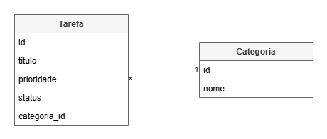
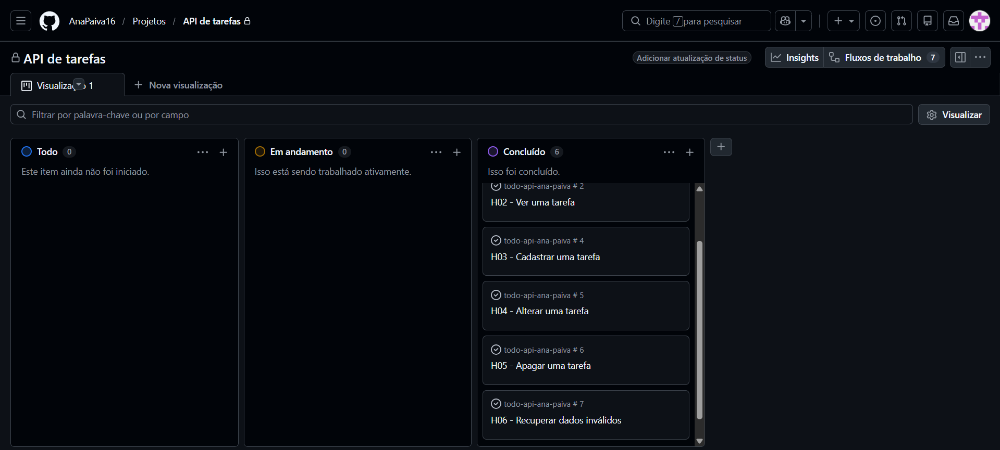

# API de Tarefas

Projeto Final Individual das UCs de **Programação Back-End** e **Projetos de Software** — Curso Técnico em Desenvolvimento de Sistemas  
Escola SENAI "Santo Paschoal Crepaldi" — Turma 1-2026-SESI_DEV_OC_1

API REST desenvolvida com **Node.js**, **Express** e **MySQL** seguindo o padrão **MVC** para organização de tarefas diárias e categorias da empresa **TaskFlow Produtividade**.

**Aluno(a):** Ana Júlia de Lima Paiva

---

## Sumário

- [Tecnologias](#tecnologias)
- [Como executar o projeto](#como-executar-o-projeto)
- [Rotas da API (Endpoints)](#rotas-da-api-endpoints)
- [Diagrama de Classes](#diagrama-de-classes)
- [Acompanhamento do Projeto (Kanban)](#acompanhamento-do-projeto-kanban)
- [Testes e Placar (`npm run conferir`)](#testes-e-placar-npm-run-conferir)
- [Reflexão Final](#reflexão-final)

---

## Tecnologias

| Tecnologia | Uso | Versão |
| :--- | :--- | :--- |
| **Node.js** | Ambiente de execução JavaScript | 18+ |
| **Express** | Criação do servidor HTTP e gerenciamento de rotas | ^5.2.1 |
| **mysql2** | Conexão com o banco de dados MySQL (com Promises) | ^3.24.6 |
| **dotenv** | Carregamento de variáveis de ambiente via `.env` | ^18.0.9 |
| **nodemon** | Reinício automático do servidor em desenvolvimento | ^3.1.14 |
| **MySQL** | Banco de dados relacional (`todo_db`) | 8.0 |

---

## Como executar o projeto

**1. Clone o repositório e acesse a pasta**

```bash
git clone <https://github.com/AnaPaiva16/todo-api-ana-paiva>
cd <todo-api-ana-paiva>
```

**2. Instale as dependências**

```bash
npm install
```

**3. Configure as variáveis de ambiente**
* Copie o arquivo `.env.example` e renomeie para `.env`.
* Abra o `.env` e insira a senha e as configurações do seu MySQL local.

**4. Crie o banco de dados**
* Abra o **MySQL Workbench**, carregue o arquivo `src/database/todo.sql` e execute o script (ícone de raio ⚡).

**5. Inicie o servidor**

```bash
npm run dev
```
> *O terminal exibirá a mensagem `Conectado ao MySQL!` confirmando que tudo está funcionando.*

**6. Rode os testes de conferência**
* Em um segundo terminal (com o servidor rodando), execute:

```bash
npm run conferir
```

---

## Rotas da API (Endpoints)

### Tarefas SPRINT's 1 e 2

| Método | Rota | Descrição | Status de Sucesso |
| :--- | :--- | :--- | :---: |
| `GET` | `/tarefas` | Lista todas as tarefas (suporta filtros por status e prioridade) | `200` |
| `GET` | `/tarefas/:id` | Busca uma tarefa específica pelo ID | `200` |
| `POST` | `/tarefas` | Cadastra uma nova tarefa | `201` |
| `PUT` | `/tarefas/:id` | Atualiza todos os dados de uma tarefa pelo ID | `200` |
| `PATCH` | `/tarefas/:id` | Atualiza parcialmente os dados de uma tarefa pelo ID | `200` |
| `DELETE` | `/tarefas/:id` | Remove uma tarefa pelo ID | `204` |
| `GET` | `/categorias` | Lista todas as categorias | `200` |
| `GET` | `/categorias/:id` | Busca uma categoria específica pelo ID | `200` |
| `POST` | `/categorias` | Cadastra uma nova categoria | `201` |
| `DELETE` | `/categorias/:id` | Remove uma categoria pelo ID | `204` |

---

## Diagrama de Classes



---

## Acompanhamento do Projeto (Kanban)

**Ferramenta utilizada:** GitHub Projects

### Sprint 1 — Tarefas

| Quadro no início do Sprint 1 | Quadro no fim do Sprint 1 |
| :---: | :---: |
|  |  |

### Sprint 2 — Categorias e Relacionamento

| Quadro no início do Sprint 2 | Quadro no fim do Sprint 2 |
| :---: | :---: |
|  |  |

---

## Testes e Placar (`npm run conferir`)

* **Sprint 1:** 14 de 14 · **Bônus:** 2 de 5
* **Sprint 2:** 14 de 14 · **Sprint 2 (Categorias):** 8 de 8 · **Bônus:** 2 de 5

---

## Reflexão Final

- **O que aprendi:** _(preencher)_
- **O que foi mais difícil:** _(preencher)_
- **O que eu faria diferente:** _(preencher)_
